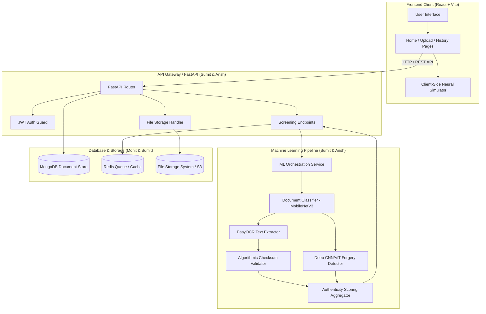
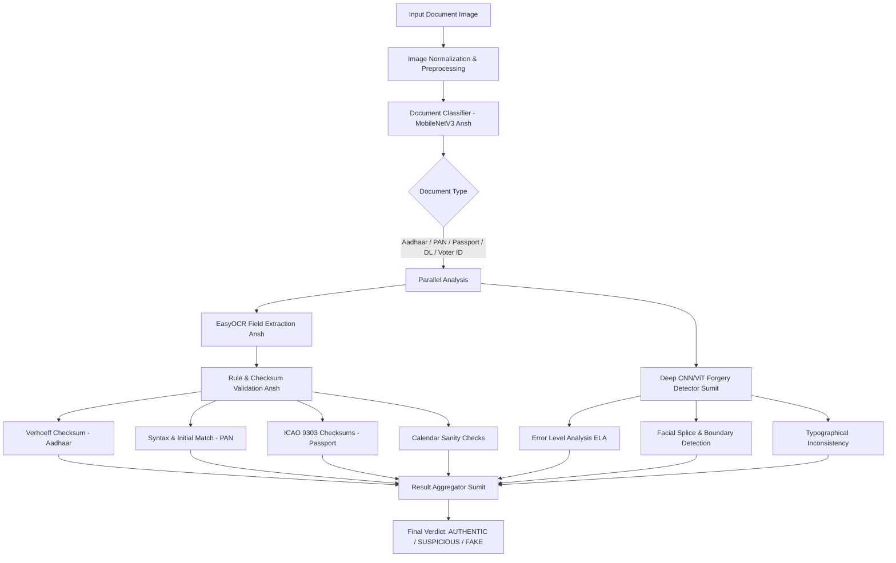

# 🛡️ AI-Based Fake Identity Document Screening System

<div align="center">


**An intelligent end-to-end verification platform designed to detect counterfeit, forged, and manipulated Indian government identity documents using Deep Learning, OCR extraction, algorithmic checksum validation, and forensic image analysis.**

[Key Features](#-features) • [Architecture](#-system-architecture) • [Team Responsibilities](#-team-members--responsibilities) • [Repository Structure](#-repository-structure--ownership) • [Quick Start](#-installation--setup) • [API Reference](#-api-overview)

</div>

---

## 📌 Problem Statement

Identity fraud is one of the fastest-growing financial and national security threats globally. In India, counterfeit identity documents (such as fake or digitally altered Aadhaar cards, PAN cards, driving licenses, passports, and voter IDs) are widely exploited in banking KYC fraud, unauthorized SIM acquisitions, fraudulent loan applications, and immigration impersonation. 

Traditional verification methods suffer from severe drawbacks:
- **Manual Human Verification:** Slow, error-prone, highly subjective, and unable to detect micro-level pixel splicing, font weight mismatches, or metadata discrepancies.
- **Surface-Level OCR:** Basic OCR engines only read printed text without verifying mathematical checksums, holographic authenticity, typographical consistency, or photo substitution.
- **Fragmented Solutions:** Verification tools typically lack automated document classification, cross-field integrity validation, and real-time fraud scoring in a unified workflow.

---

## 🎯 Project Objectives

1. **Automated Multi-Class Document Identification:** Classify uploaded Indian identity documents automatically using deep learning vision classifiers without requiring manual document type selection.
2. **Multi-Layered Forgery Detection:** Identify digital tampering, photo splicing, boundary discontinuities, text alterations, and stamp/emblem anomalies using Convolutional Neural Networks (CNN) and Vision Transformers (ViT).
3. **High-Precision OCR & Field Validation:** Extract critical alphanumeric fields (Aadhaar number, PAN, MRZ codes, dates, names) using EasyOCR and validate them against official syntax algorithms (e.g., Verhoeff checksum for Aadhaar, ICAO 9303 for passports, PAN structure rules).
4. **Actionable Authenticity Auditing:** Generate deterministic authenticity verdicts (`AUTHENTIC`, `SUSPICIOUS`, `FAKE`) backed by granular confidence scores, highlighted tamper regions, and comprehensive audit logs.
5. **Production-Ready Enterprise Stack:** Deliver a responsive React single-page application, an asynchronous FastAPI backend service, scalable MongoDB document storage, and containerized Docker deployment.

---

## 🚀 Features

- 🔍 **Instant Document Classification:** Automatic layout identification for all major Indian national identity credentials.
- 🔬 **Deep Forensic Tamper Detection:** Micro-level inspection for cut-and-paste photo replacement, copy-move forgery, font glyph inconsistencies, and double compression artifacts.
- 🔤 **Bilingual OCR Text Extraction:** OCR extraction supporting English and Hindi scripts with field-level bounding box mapping.
- 🧮 **Algorithmic Field Validation:**
  - **Aadhaar Card:** Verhoeff mathematical check digit calculation and 12-digit spacing syntax.
  - **PAN Card:** 10-character alphanumeric structure validation (including 4th character entity type and 5th character surname initial match).
  - **Passport:** Full dual-line ICAO 9303 Machine Readable Zone (MRZ) parsing and composite checksum verification.
  - **Driving License:** MoRTH / Sarathi state code format and expiration/validity checks.
  - **Voter ID (EPIC):** Election Commission alphanumeric code formatting and constituency syntax checks.
- 📊 **Screening History & Audit Records:** Comprehensive history table with keyword search, multi-factor filtering (document type, risk level, date range), and one-click CSV audit report exports.
- ⚡ **Offline-Ready Client Simulation:** The frontend client incorporates a high-fidelity client-side neural screening simulator allowing complete UI/UX workflows even when the backend API service is offline.
- 🛡️ **Role-Based Security & Governance:** JWT-based user authentication, role-based access controls (User vs. Admin), and protected administrative oversight dashboards.

---

## 📄 Supported Identity Documents

| Document | Primary Issuing Authority | Key Fields Extracted & Validated | Security & Anti-Fraud Checks |
| :--- | :--- | :--- | :--- |
| **🪪 Aadhaar Card** | UIDAI | Name, DOB, Gender, 12-digit Aadhaar No., Address | Verhoeff check-digit algorithm, UIDAI emblem verification, photo border continuity, calendar date sanity checks |
| **💳 PAN Card** | Income Tax Department (ITD) | Name, Father's Name, DOB, 10-char PAN No. | 5th-character surname correspondence, ITD seal geometry, font typeface conformity (OCR-B), date format check |
| **🛂 Passport** | Ministry of External Affairs (MEA) | Surname, Given Name, Passport No., Nationality, DOB, Expiry Date, MRZ lines | ICAO Doc 9303 dual-line MRZ checksums, biometric ghost photo validation, expiration date validity |
| **🚗 Driving License** | MoRTH / State RTOs | License No., Name, DOB, Validity, Authorized Vehicle Classes | RTO jurisdiction code parsing, license number regex pattern, micro-smart chip area illumination checks |
| **🗳️ Voter ID (EPIC)** | Election Commission of India (ECI) | EPIC No., Name, Relation Name, DOB/Age, Assembly Constituency | EPIC alphanumeric code sequence validation, ECI holographic emblem checks |

---

## 🛠️ Technology Stack

```
AI-Based Fake Identity Document Screening System
│
├── 🎨 Frontend Architecture
│   ├── Framework: React 18.3 (Single Page Application)
│   ├── Tooling & Bundler: Vite 6.2
│   ├── Styling: Tailwind-inspired modern CSS layout with responsive design
│   ├── Component Icons: Lucide React
│   ├── State & Routing: Native Browser PushState & Hash Routing, Context API
│   └── Offline Capability: Built-in Neural Screening Simulator & LocalStorage sync
│
├── ⚙️ Backend Architecture
│   ├── Web Framework: FastAPI 0.111.0 (Async ASGI)
│   ├── Application Server: Uvicorn 0.30.1
│   ├── Validation: Pydantic v2 & Pydantic-Settings
│   ├── Authentication: OAuth2 with Password Bearer, JWT (python-jose), Passlib (Bcrypt)
│   ├── Task Queues: Celery 5.4.0 with Redis 7.0 (Background inference & processing)
│   └── File Handling: Aiofiles, Python-Multipart, local filesystem / AWS S3 abstraction
│
├── 🗄️ Database Architecture
│   ├── Primary Database: MongoDB 6.0+ (Document Store & Data Organization)
│   ├── Database Driver / ODM: Motor / PyMongo (Async MongoDB Driver)
│   ├── Transitional Scaffold: PostgreSQL 15+ with Async SQLAlchemy (ORM models)
│   └── Cache & Broker: Redis 7.0 Alpine
│
├── 🧠 Machine Learning & Computer Vision
│   ├── Deep Learning Framework: PyTorch 2.3+ & Torchvision
│   ├── Document Classifier: MobileNetV3 / EfficientNet / Zero-shot CLIP
│   ├── Forgery Detection: CNN / Vision Transformer (ViT-B/16) with Error Level Analysis (ELA)
│   ├── Optical Character Recognition: EasyOCR (bilingual en/hi) & Tesseract fallback
│   ├── Image Processing: OpenCV, Pillow, NumPy, SciPy
│   └── Validation Algorithms: Verhoeff algorithm, ICAO 9303 checksum parser
│
└── 🚢 DevOps & Infrastructure
    ├── Containerization: Docker & Docker Compose (v3.9)
    ├── Continuous Integration: GitHub Actions CI (.github/workflows/ci.yml)
    └── OS Compatibility: Cross-platform (Windows, Linux, macOS)
```

---

## 👥 Team Members & Responsibilities

The project is developed by a dedicated five-member engineering team. Each member owns specialized modules across the stack:

| Team Member | Core Role | Primary Responsibilities | Module Ownership |
| :--- | :--- | :--- | :--- |
| **Abhilash Jha** | **Frontend Developer** | • Authentication UI (Login & Registration views)<br>• Frontend routing, navigation, and protected routes<br>• Admin panel user interface<br>• Frontend state management architecture<br>• Common shared UI components (Navbar, Footer, Sidebar, Toast notifications)<br>• Frontend-to-backend API integration for assigned features | `frontend/src/components/auth/`<br>`frontend/src/components/admin/`<br>`frontend/src/components/common/`<br>`frontend/src/store/`<br>`frontend/src/App.jsx` |
| **Shubham Kumar** | **Frontend Developer** | • Interactive Landing / Home page experience<br>• Document Upload UI with drag-and-drop file dropzone<br>• Document History page with real-time filtering & search<br>• Screening result visualization & detail inspection modals<br>• Upload-related UI components and client screening simulator | `frontend/src/pages/`<br>`frontend/src/components/home/`<br>`frontend/src/components/upload/`<br>`frontend/src/components/history/`<br>`frontend/src/services/` |
| **Mohit Trivedi** | **Database Developer** | • **MongoDB database setup, configuration, and maintenance**<br>• Database architecture and NoSQL schema design<br>• Collection structure, indexing, and data organization<br>• Database validation rules and schema models<br>• Database integration support with FastAPI backend services<br>• Database technical documentation and optimization | **Database Layer**<br>`backend/app/core/database.py`<br>`backend/app/models/`<br>`docs/WORK_DIVISION.md` |
| **Sumit Kumar Barnwal** | **Backend Lead / ML Developer** | • Backend architecture, configuration, and core FastAPI application<br>• Authentication and authorization backend (OAuth2, JWT, password hashing)<br>• Administrative management APIs<br>• Secure document storage handling (local & S3-compatible service)<br>• Deep learning forgery detection model (CNN/ViT)<br>• ML pipeline orchestration service<br>• Docker containerization and CI/CD pipeline infrastructure | `backend/app/main.py`<br>`backend/app/core/config.py`<br>`backend/app/core/security.py`<br>`backend/app/api/routes/auth.py`<br>`backend/app/api/routes/documents.py`<br>`backend/app/api/routes/admin.py`<br>`backend/app/services/ml_service.py`<br>`backend/app/services/storage_service.py`<br>`ml/models/forgery_detector/`<br>`docker-compose.yml`<br>`.github/workflows/ci.yml` |
| **Ansh** | **Backend / ML Developer** | • Document screening API endpoints<br>• Document type classification model (MobileNetV3 / CLIP)<br>• OCR extraction pipeline (EasyOCR / Tesseract)<br>• Field validation and algorithmic checksum verification (Verhoeff, ICAO)<br>• Celery asynchronous task distribution & worker pipeline<br>• Backend unit testing and integration testing with pytest | `backend/app/api/routes/screening.py`<br>`backend/app/services/ocr_service.py`<br>`backend/tests/`<br>`ml/models/document_classifier/`<br>`ml/models/ocr_pipeline/` |

> ⚠️ **Important Responsibility Scope Clarification:**  
> **Mohit Trivedi is solely responsible for the Database Layer (MongoDB setup, schema design, collections, models, and integration).** He is not assigned to frontend UI features. The frontend implementation is exclusively led and maintained by **Abhilash Jha** and **Shubham Kumar**.

---

## 📁 Repository Structure & Ownership

```
AI-Based-Fake-Identity-Document-Screening-System/
│
├── 📂 backend/                                   ← Backend & API Services
│   ├── app/
│   │   ├── api/
│   │   │   └── routes/
│   │   │       ├── auth.py                      ← Sumit  (Registration, Login, JWT tokens, Me profile)
│   │   │       ├── documents.py                 ← Sumit  (File upload, List documents, Get, Delete)
│   │   │       ├── admin.py                     ← Sumit  (User management, System statistics, Flagged docs)
│   │   │       └── screening.py                 ← Ansh   (Analyze trigger, Results, Screening history, Stats)
│   │   ├── core/
│   │   │   ├── config.py                        ← Sumit  (Pydantic environment settings & configuration)
│   │   │   ├── security.py                      ← Sumit  (JWT tokens, Bcrypt password hashing, Auth guards)
│   │   │   └── database.py                      ← Mohit (Lead) + Sumit (MongoDB & DB engine connection)
│   │   ├── models/                              ← Mohit (Lead) + Sumit (Database models & schemas)
│   │   │   ├── user.py                          ← User schema (credentials, role, status)
│   │   │   ├── document.py                      ← Document schema (metadata, file paths, upload status)
│   │   │   └── screening_result.py              ← ScreeningResult schema (verdicts, scores, indicators)
│   │   ├── services/
│   │   │   ├── ml_service.py                    ← Sumit  (ML pipeline orchestration & model loading)
│   │   │   ├── ocr_service.py                   ← Ansh   (OCR pipeline wrapper & text parsing)
│   │   │   └── storage_service.py               ← Sumit  (Local/S3 asynchronous file persistence)
│   │   └── main.py                              ← Sumit  (FastAPI entrypoint, middleware, CORS, routing)
│   ├── tests/                                   ← Ansh   (Pytest test suites & integration tests)
│   ├── requirements.txt                         ← Backend dependencies (FastAPI, PyMongo, SQLAlchemy, etc.)
│   └── .env.example                             ← Environment variables template
│
├── 📂 ml/                                        ← Machine Learning & Computer Vision
│   ├── models/
│   │   ├── forgery_detector/                    ← Sumit  (Deep CNN/ViT Forgery Detection Architecture)
│   │   │   └── model.py                         (PyTorch CNN/ViT model & inference pipeline)
│   │   ├── ocr_pipeline/                        ← Ansh   (OCR Extraction & Algorithmic Validation)
│   │   │   ├── extractor.py                     (EasyOCR / Tesseract engine text extraction)
│   │   │   └── validator.py                     (Verhoeff checksum, PAN regex, MRZ & date validation)
│   │   └── document_classifier/                 ← Ansh   (Document Classification)
│   │       └── classifier.py                    (MobileNetV3 image classifier for 5 ID types)
│   ├── data/
│   │   ├── preprocessing/                       ← Sumit  (Image augmentation, normalization, ELA transforms)
│   │   └── datasets/                            (Local datasets directory — excluded from git)
│   ├── notebooks/                               ← Sumit + Ansh (Model training, EDA, and evaluation)
│   ├── saved_models/                            (Trained model weights .pth/.onnx — excluded from git)
│   └── requirements.txt                         ← ML dependencies (PyTorch, Torchvision, EasyOCR, OpenCV)
│
├── 📂 frontend/                                  ← React SPA Frontend
│   ├── src/
│   │   ├── components/
│   │   │   ├── auth/                            ← Abhilash (Login, Registration, ProtectedRoute components)
│   │   │   ├── admin/                           ← Abhilash (Admin UserTable, DocumentManager, SystemMetrics)
│   │   │   ├── common/                          ← Abhilash (Navbar, Footer, Sidebar, Toast notification system)
│   │   │   ├── home/                            ← Shubham  (HeroSection, FeatureGrid, DocTypesShowcase, HowItWorks)
│   │   │   ├── upload/                          ← Shubham  (FileDropzone, DocTypeSelector, ImagePreview, ScreeningResultModal)
│   │   │   ├── history/                         ← Shubham  (HistoryTable, FilterBar, HistoryDetailModal, StatusBadge)
│   │   │   ├── dashboard/                       ← Abhilash / Shared (Analytics & visualization components)
│   │   │   └── results/                         ← Shubham / Shared (Detailed result cards & fraud badges)
│   │   ├── pages/                               ← Shubham + Abhilash
│   │   │   ├── HomePage.jsx                     ← Shubham  (Platform introduction & showcase)
│   │   │   ├── UploadPage.jsx                   ← Shubham  (Document submission & instant verification)
│   │   │   └── HistoryPage.jsx                  ← Shubham  (Audit trail, search, filters & CSV export)
│   │   ├── services/
│   │   │   ├── documentService.js               ← Shubham  (API integration with neural screening simulator fallback)
│   │   │   └── mockData.js                      ← Shubham  (Comprehensive mock screening datasets & samples)
│   │   ├── store/                               ← Abhilash (Frontend global state management)
│   │   ├── App.jsx                              ← Abhilash + Shubham (Core routing, layout, and state setup)
│   │   ├── index.css                            ← Global design tokens, typography, and utility styles
│   │   └── main.jsx                             ← React DOM application mounting
│   ├── package.json                             ← Frontend dependencies & scripts
│   └── vite.config.js                           ← Vite development server & reverse proxy configuration
│
├── 📂 docs/                                      ← Technical Documentation
│   ├── WORK_DIVISION.md                         ← Full file-level team responsibility matrix
│   ├── SETUP.md                                 ← Comprehensive local development setup guide
│   ├── API.md                                   ← REST API specifications & schemas
│   └── ML_PIPELINE.md                           ← Deep learning & computer vision architecture guide
│
├── docker-compose.yml                           ← Sumit  (Multi-container stack: API, DB, Redis, Celery)
├── .github/workflows/ci.yml                     ← Sumit  (Automated CI workflow for testing & linting)
├── .gitignore                                   ← Ignore rules for Python, Node, ML weights & datasets
└── README.md                                    ← Project documentation & presentation guide
```

---

## 🏛️ System Architecture



---

## 💻 Frontend Architecture & Feature Ownership

The frontend is built using **React 18** and **Vite**, prioritizing performance, visual polish, and clean separation of concerns.

### Feature Ownership Division:
- **Abhilash Jha — Frontend Developer:**
  - **Authentication Experience:** User registration, login forms, token persistence, and route protection guards.
  - **Administrative UI:** User management table, role modification controls, and system health status.
  - **Shared UI Library:** Reusable components including [Navbar.jsx](file:///frontend/src/components/common/Navbar.jsx), [Footer.jsx](file:///frontend/src/components/common/Footer.jsx), [Sidebar.jsx](file:///frontend/src/components/common/Sidebar.jsx), and [Toast.jsx](file:///frontend/src/components/common/Toast.jsx).
  - **Application Navigation & State:** URL hash/pushState synchronizer in [App.jsx](file:///frontend/src/App.jsx) and global state architecture in `frontend/src/store/`.
- **Shubham Kumar — Frontend Developer:**
  - **Landing Page:** Animated [HeroSection.jsx](file:///frontend/src/components/home/HeroSection.jsx), [FeatureGrid.jsx](file:///frontend/src/components/home/FeatureGrid.jsx), [DocTypesShowcase.jsx](file:///frontend/src/components/home/DocTypesShowcase.jsx), and [HowItWorks.jsx](file:///frontend/src/components/home/HowItWorks.jsx).
  - **Document Upload Interface:** Drag-and-drop [FileDropzone.jsx](file:///frontend/src/components/upload/FileDropzone.jsx), document type picker [DocTypeSelector.jsx](file:///frontend/src/components/upload/DocTypeSelector.jsx), and real-time image preview in [ImagePreview.jsx](file:///frontend/src/components/upload/ImagePreview.jsx).
  - **Interactive Results Modal:** Comprehensive [ScreeningResultModal.jsx](file:///frontend/src/components/upload/ScreeningResultModal.jsx) displaying authenticity verdict badges, confidence progress bars, extracted OCR fields, and specific fraud indicators.
  - **History & Audit System:** Filterable [HistoryTable.jsx](file:///frontend/src/components/history/HistoryTable.jsx), [FilterBar.jsx](file:///frontend/src/components/history/FilterBar.jsx), [StatusBadge.jsx](file:///frontend/src/components/history/StatusBadge.jsx), detailed record view [HistoryDetailModal.jsx](file:///frontend/src/components/history/HistoryDetailModal.jsx), and CSV report export.
  - **Client-Side Simulation:** Integrated [documentService.js](file:///frontend/src/services/documentService.js) with intelligent fallback neural screening simulation when the backend is offline.

---

## ⚙️ Backend Architecture & Ownership

The backend service is powered by **FastAPI** with asynchronous request handlers for high-throughput screening operations.

### Feature Ownership Division:
- **Sumit Kumar Barnwal — Backend Lead:**
  - **Core Application Engine:** FastAPI application setup, global exception handlers, CORS configuration, and ASGI life-cycle management ([main.py](file:///backend/app/main.py)).
  - **Security & Identity:** Password hashing with bcrypt, JWT token generation and validation, and OAuth2 security dependencies ([security.py](file:///backend/app/core/security.py), [auth.py](file:///backend/app/api/routes/auth.py)).
  - **Document Storage Service:** Asynchronous file persistence with unique UUID generation, file extension whitelisting, file size validation, and disk cleanup ([storage_service.py](file:///backend/app/services/storage_service.py), [documents.py](file:///backend/app/api/routes/documents.py)).
  - **Admin API Suite:** User listing, role updates, system-wide metrics aggregation, and flagged document monitoring ([admin.py](file:///backend/app/api/routes/admin.py)).
  - **Infrastructure:** Docker container configurations and GitHub Actions CI pipelines ([docker-compose.yml](file:///docker-compose.yml), [.github/workflows/ci.yml](file:///.github/workflows/ci.yml)).
- **Ansh — Backend Developer:**
  - **Screening Endpoints:** Analysis triggering (`/api/v1/screening/analyze`), single result lookup (`/api/v1/screening/result/{id}`), user history retrieval (`/api/v1/screening/history`), and summary statistics (`/api/v1/screening/stats`) ([screening.py](file:///backend/app/api/routes/screening.py)).
  - **OCR Integration Service:** Backend service layer bridging OCR extraction results to API response models ([ocr_service.py](file:///backend/app/services/ocr_service.py)).
  - **Testing Infrastructure:** Automated test suites covering route responses, authentication flows, and validation logic in `backend/tests/`.

---

## 🗄️ MongoDB Database Architecture & Ownership

> 👤 **Module Lead:** **Mohit Trivedi (Database Developer)**  
> **Scope:** Mohit is responsible for database architecture, MongoDB configuration, document schema design, collections organization, indexing strategies, and database integration support.

MongoDB provides high performance, horizontal scalability, and JSON-native flexibility essential for handling variable OCR structures across diverse identity credentials.

### MongoDB Collections Schema Design:

#### 1. `users` Collection
Stores registered user accounts, administrative privileges, and security credentials.
```json
{
  "_id": "ObjectId('65f1a2b3c4d5e6f7a8b9c0d1')",
  "id": "550e8400-e29b-41d4-a716-446655440000",
  "email": "user@example.com",
  "username": "user123",
  "full_name": "Aditya Sharma",
  "hashed_password": "$2b$12$eA8rQz9k...",
  "role": "user",
  "is_active": true,
  "created_at": "2026-11-27T10:00:00Z",
  "updated_at": "2026-11-27T10:00:00Z"
}
```
*Indexes:* `{ "email": 1 }` (unique), `{ "username": 1 }` (unique).

#### 2. `documents` Collection
Tracks uploaded file metadata, storage locations, and processing status.
```json
{
  "_id": "ObjectId('65f1a2b3c4d5e6f7a8b9c0d2')",
  "id": "doc-uuid-string",
  "user_id": "550e8400-e29b-41d4-a716-446655440000",
  "original_filename": "aadhaar_sample.jpg",
  "stored_filename": "3f82a9bc-9981.jpg",
  "file_path": "uploads/550e8400.../3f82a9bc-9981.jpg",
  "file_size": 1542090,
  "mime_type": "image/jpeg",
  "document_type": "aadhaar",
  "status": "completed",
  "created_at": "2026-11-27T10:05:00Z",
  "updated_at": "2026-11-27T10:05:02Z"
}
```
*Indexes:* `{ "user_id": 1, "created_at": -1 }`, `{ "stored_filename": 1 }` (unique).

#### 3. `screening_results` Collection
Stores comprehensive ML screening outputs, confidence scores, extracted fields, and fraud indicators.
```json
{
  "_id": "ObjectId('65f1a2b3c4d5e6f7a8b9c0d3')",
  "id": "result-uuid-string",
  "document_id": "doc-uuid-string",
  "user_id": "550e8400-e29b-41d4-a716-446655440000",
  "verdict": "authentic",
  "confidence_score": 0.982,
  "forgery_score": 0.018,
  "ocr_validation_score": 0.995,
  "ocr_fields": {
    "name": "Rahul Sharma",
    "dob": "14/08/1992",
    "gender": "Male",
    "id_number": "4829 1049 8921",
    "address": "Gurugram, Haryana - 122001"
  },
  "fraud_indicators": [
    { "type": "photo_tampering", "detected": false, "score": 0.02, "description": "Facial boundary continuous" },
    { "type": "text_tampering", "detected": false, "score": 0.01, "description": "Font kerning consistent" }
  ],
  "validation_errors": [],
  "processing_time_ms": 742,
  "created_at": "2026-11-27T10:05:02Z"
}
```
*Indexes:* `{ "document_id": 1 }` (unique), `{ "user_id": 1, "created_at": -1 }`, `{ "verdict": 1 }`.

---

## 🧠 ML & OCR Pipeline Architecture

The machine learning subsystem consists of four coordinated modules:



### Module Responsibilities:
1. **Document Classifier (`ml/models/document_classifier/`) — Ansh:**  
   Fine-tuned MobileNetV3 network classifies the document image into one of five categories: `aadhaar`, `pan`, `passport`, `driving_license`, or `voter_id`.
2. **OCR Pipeline (`ml/models/ocr_pipeline/`) — Ansh:**  
   Bilingual text extraction using EasyOCR with contrast-enhanced thresholding. Formats extracted text into structured key-value pairs according to document schema.
3. **Algorithmic Field Validator (`ml/models/ocr_pipeline/validator.py`) — Ansh:**  
   Mathematical verification algorithms including the Verhoeff base-10 dihedral check algorithm, ICAO 9303 MRZ dual check digit validation, and regular expression format guards.
4. **Deep Forgery Detector (`ml/models/forgery_detector/`) — Sumit:**  
   Custom PyTorch CNN / ViT architecture performing patch-level image anomaly detection, photo boundary discontinuity checks, and digital cut-and-paste identification.
5. **ML Orchestration Service (`backend/app/services/ml_service.py`) — Sumit:**  
   Loads model weights into memory at startup and computes composite confidence scores using weighted heuristic aggregation:
   $$\text{Final Risk Score} = 0.50 \times \text{Forgery Score} + 0.35 \times (1 - \text{OCR Score}) + 0.15 \times \text{Heuristic Anomalies}$$

---

## 📚 API Overview

The FastAPI service exposes structured RESTful endpoints versioned under `/api/v1`:

| Method | Endpoint | Module Owner | Description | Status |
| :--- | :--- | :--- | :--- | :--- |
| `POST` | `/api/v1/auth/register` | Sumit | Register a new user account with email, username & password | ✅ Implemented |
| `POST` | `/api/v1/auth/login` | Sumit | Authenticate user credentials and issue JWT access + refresh tokens | ✅ Implemented |
| `POST` | `/api/v1/auth/refresh` | Sumit | Exchange refresh token for a new access token pair | ✅ Implemented |
| `GET` | `/api/v1/auth/me` | Sumit | Retrieve profile details of the currently authenticated user | ✅ Implemented |
| `POST` | `/api/v1/documents/upload` | Sumit | Upload an identity document image or PDF for screening | ✅ Implemented |
| `GET` | `/api/v1/documents/` | Sumit | List user's uploaded documents with pagination support | ✅ Implemented |
| `GET` | `/api/v1/documents/{id}` | Sumit | Retrieve single document metadata and upload status | ✅ Implemented |
| `DELETE` | `/api/v1/documents/{id}` | Sumit | Delete document file from disk and database record | ✅ Implemented |
| `POST` | `/api/v1/screening/analyze` | Ansh | Trigger asynchronous ML screening analysis on an uploaded document | ⏳ Scaffolded |
| `GET` | `/api/v1/screening/result/{id}` | Ansh | Fetch granular screening results, confidence scores & indicators | ⏳ Scaffolded |
| `GET` | `/api/v1/screening/history` | Ansh | Retrieve paginated screening audit history for the current user | ⏳ Scaffolded |
| `GET` | `/api/v1/screening/stats` | Ansh | Summary statistics (total screenings, fraud rates, authentic count) | ⏳ Scaffolded |
| `GET` | `/api/v1/admin/users` | Sumit | Administrative listing of all system users (Admin role required) | ✅ Implemented |
| `GET` | `/api/v1/admin/users/{id}` | Sumit | Retrieve specific user account profile (Admin role required) | ✅ Implemented |
| `PATCH` | `/api/v1/admin/users/{id}` | Sumit | Update user status or assign administrative role (Admin role required) | ✅ Implemented |
| `GET` | `/api/v1/admin/documents` | Sumit | Administrative listing of all documents across the platform | ✅ Implemented |
| `GET` | `/api/v1/admin/documents/flagged`| Sumit | List all documents flagged with `SUSPICIOUS` or `FAKE` verdicts | ✅ Implemented |
| `GET` | `/api/v1/admin/stats` | Sumit | Platform-wide screening statistics, fraud ratios & system throughput | ✅ Implemented |

---

## 🚀 Installation & Setup

### Prerequisites
- **Python:** 3.11 or higher
- **Node.js:** v18 or v20 LTS (with npm)
- **MongoDB:** 6.0+ (Local community edition or MongoDB Atlas)
- **Docker & Docker Compose:** Optional for containerized deployment

---

### Step 1: Clone Repository
```bash
git clone https://github.com/sumitkumarbarnwal/AI-Based-Fake-Identity-Document-Screening-System.git
cd AI-Based-Fake-Identity-Document-Screening-System
```

---

### Step 2: Backend Setup (Sumit / Ansh / Mohit)

1. Navigate to the backend directory:
   ```bash
   cd backend
   ```
2. Create and activate a virtual environment:
   ```bash
   # Windows (PowerShell)
   python -m venv venv
   .\venv\Scripts\Activate.ps1

   # Linux / macOS
   python3 -m venv venv
   source venv/bin/activate
   ```
3. Install dependencies:
   ```bash
   pip install -r requirements.txt
   ```
4. Configure environment variables:
   ```bash
   cp .env.example .env
   # Edit .env to set your SECRET_KEY and MONGODB_URI
   ```
5. Start the FastAPI development server:
   ```bash
   uvicorn app.main:app --reload --host 0.0.0.0 --port 8000
   ```
   - **API URL:** `http://localhost:8000`
   - **Interactive API Documentation:** `http://localhost:8000/docs`

---

### Step 3: Frontend Setup (Abhilash / Shubham)

1. Open a new terminal and navigate to the frontend directory:
   ```bash
   cd frontend
   ```
2. Install npm packages:
   ```bash
   npm install
   ```
3. Launch Vite development server:
   ```bash
   npm run dev
   ```
   - **Web Application URL:** `http://localhost:3000`

---

### Step 4: Machine Learning Setup (Sumit / Ansh)

1. Navigate to the ML directory:
   ```bash
   cd ml
   ```
2. Install PyTorch, Computer Vision, and OCR dependencies:
   ```bash
   pip install -r requirements.txt
   ```
3. Launch Jupyter for exploration and model training notebooks:
   ```bash
   jupyter notebook
   ```

---

### Step 5: Full Stack Deployment via Docker

To launch the complete multi-service stack (FastAPI Backend, React Frontend, MongoDB, Redis, and Celery):
```bash
docker-compose up --build
```

---

## 🔐 Environment Variables

The backend reads configuration settings from `backend/.env`. Refer to [backend/.env.example](file:///backend/.env.example):

| Variable | Default Value | Description |
| :--- | :--- | :--- |
| `APP_NAME` | `AI Fake Document Screening System` | Application display name |
| `DEBUG` | `True` | Enable debug logs and verbose errors |
| `SECRET_KEY` | `change-this-in-production...` | Secret key for JWT signature encoding |
| `ALGORITHM` | `HS256` | JWT cryptographic signing algorithm |
| `ACCESS_TOKEN_EXPIRE_MINUTES` | `1440` | JWT access token validity period (24 hours) |
| `MONGODB_URI` | `mongodb://localhost:27017` | MongoDB connection URI (Mohit) |
| `MONGODB_DB_NAME` | `screening_db` | Target MongoDB database name |
| `REDIS_URL` | `redis://localhost:6379` | Redis broker and caching URL |
| `UPLOAD_DIR` | `uploads` | Directory for temporary file storage |
| `MAX_FILE_SIZE_MB` | `10` | Maximum allowable file upload size (MB) |
| `FORGERY_MODEL_PATH` | `../ml/saved_models/forgery_detector.pth` | Weights path for deep forgery CNN/ViT |
| `CLASSIFIER_MODEL_PATH` | `../ml/saved_models/doc_classifier.pth` | Weights path for document classifier |

---

## 🔀 Git Branching & Collaboration Workflow

To maintain a clean and reliable codebase, the team follows a structured Git workflow:

```
main (Production Branch - Protected)
 └── develop (Integration Branch - All PRs merged here)
       ├── feature/abhilash-frontend     ← Abhilash (Auth, Admin, Common UI, Store)
       ├── feature/shubham-frontend      ← Shubham  (Home, Upload, History UI, Services)
       ├── feature/mohit-database        ← Mohit    (MongoDB schemas, collections & setup)
       ├── feature/sumit-backend         ← Sumit    (Core API, Auth, Storage, Admin)
       ├── feature/sumit-ml              ← Sumit    (Deep Forgery CNN/ViT Model)
       ├── feature/ansh-backend          ← Ansh     (Screening API, Celery tasks, Tests)
       └── feature/ansh-ml               ← Ansh     (Document Classifier & OCR pipeline)
```

### Git Collaboration Rules:
1. **Never commit directly to `main` or `develop`:** All work must be conducted on designated feature branches.
2. **Branch Naming Standard:** `feature/<name>-<module>` (e.g., `feature/mohit-database`, `feature/abhilash-frontend`).
3. **Commit Message Format:** Use conventional commits:
   - `feat(auth): implement user registration and login forms`
   - `feat(db): configure mongodb connection and user collection schemas`
   - `fix(ocr): resolve verhoeff checksum edge cases for aadhaar`
   - `docs(readme): update team responsibilities and database architecture`
4. **Pull Requests:** Open PRs targeting `develop`. Each PR must pass automated CI checks before merging.

---

## 🧪 Testing Instructions

### Backend & API Testing
Run automated unit and integration tests using `pytest`:
```bash
cd backend
pytest tests/ -v
```

### Frontend Code Quality
Validate React components and JavaScript syntax:
```bash
cd frontend
npm run build
```

---

## 🗺️ Project Roadmap & Milestones

- [x] **Milestone 1 — Repository Scaffolding & Architecture Design**
  - Unified monorepo structure with clear ownership annotations
  - Complete frontend UI prototype (Home, Upload, History) with client simulation
  - Core FastAPI routing, JWT authentication, and file storage handlers
- [x] **Milestone 2 — Documentation & Work Division Alignment**
  - Accurate team responsibility matrix reflecting Mohit as Database Developer
  - Comprehensive documentation files ([WORK_DIVISION.md](file:///docs/WORK_DIVISION.md), [SETUP.md](file:///docs/SETUP.md), [API.md](file:///docs/API.md), [ML_PIPELINE.md](file:///docs/ML_PIPELINE.md))
- [ ] **Milestone 3 — Database & ML Model Integration**
  - MongoDB collection schemas and asynchronous connection integration (Mohit)
  - MobileNetV3 document classifier weights loading & evaluation (Ansh)
  - EasyOCR text parsing and Verhoeff/ICAO validation pipelines (Ansh)
  - PyTorch CNN/ViT forgery detection inference integration (Sumit)
- [ ] **Milestone 4 — Full Stack End-to-End Orchestration**
  - Celery background queue processing for heavy document analysis tasks
  - Frontend authentication UI (Login/Register) and Admin panel completion (Abhilash)
  - End-to-end API integration connecting React upload directly to live ML pipeline
- [ ] **Milestone 5 — Production Hardening & Demonstration**
  - Docker Compose multi-container staging deployment
  - Comprehensive integration test suite and synthetic benchmark evaluation
  - Live project demonstration and portfolio release

---

## 🔮 Future Improvements

1. **Zero-Knowledge Privacy Verification:** Verify document validity without storing plain-text PII (Personally Identifiable Information) on persistent storage.
2. **Mobile Camera OCR & Edge Inference:** WebAssembly (Wasm) or ONNX Runtime client-side model inference for instant edge screening on mobile browsers.
3. **Advanced Biometric Liveness Superposition:** Cross-reference facial portrait on identity document with a live webcam video liveness feed.
4. **Government Portal Verification Connectors:** Sandboxed API integration with DigiLocker / UIDAI / ITD verification gateways for real-time document status resolution.

---

## 🏆 Credits & Contributors

Developed with dedication by:
- 👨‍💻 **Abhilash Jha** — Frontend Developer ([@abhilashjha](https://github.com/))
- 👨‍💻 **Shubham Kumar** — Frontend Developer ([@shubhamkumar](https://github.com/))
- 👨‍💻 **Mohit Trivedi** — Database Developer ([@mohittrivedi](https://github.com/))
- 👨‍💻 **Sumit Kumar Barnwal** — Backend Lead / ML Developer ([@sumitkumarbarnwal](https://github.com/sumitkumarbarnwal))
- 👨‍💻 **Ansh** — Backend / ML Developer ([@ansh](https://github.com/))

---

<div align="center">
  <sub>AI-Based Fake Identity Document Screening System • Built for Security, Reliability, and Trust.</sub>
</div>
